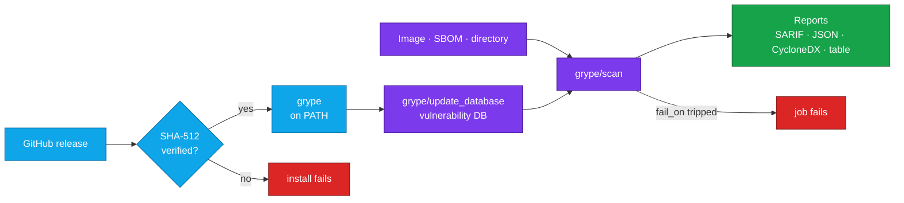

<div align="center">


# Grype Orb for CircleCI

### Find known vulnerabilities in your images and SBOMs before they ship.

Install [Grype](https://github.com/anchore/grype), scan container images, SBOMs and source trees, and fail the build<br>
when a vulnerability crosses the severity line you set, with three steps of CircleCI config.<br>
Strict SHA-512 verification by default · No `sudo` · amd64 and arm64

[](https://circleci.com/gh/juburr/grype-orb)
[](https://circleci.com/developer/orbs/orb/juburr/grype-orb)
[](LICENSE)
[](https://discuss.circleci.com/c/ecosystem/orbs)


**[Quick Start](#-quick-start)** · **[Features](#-why-grype-orb)** · **[Reports](#-reports)** · **[VEX](#-vex)** · **[Recipes](#-recipes)** · **[Commands](#-commands)** · **[Security](#-secure-by-design)**

<sub>An unofficial, community-maintained orb. [Contributions are welcome!](#-contributing)</sub>

</div>

<br>

## ✨ Why grype-orb?

<table>
<tr>
<td width="33%" valign="top">
🔒 <b>Secure by default</b><br><br>
No <code>sudo</code>, anywhere. Every Grype binary is checked against a pinned SHA-512 checksum, and an unknown version <a href="#-checksum-verification">fails closed</a>.
</td>
<td width="33%" valign="top">
🎯 <b>Scans more than images</b><br><br>
Container images, SBOMs, directories, registries, OCI layouts, CPE lists and Zarf packages. Anything Grype can read. See <a href="#-scan-sources">Scan Sources</a>.
</td>
<td width="33%" valign="top">
🚦 <b>Gates your builds</b><br><br>
Set <code>fail_on: high</code> and the job fails when a match at or above that severity turns up. Add <code>only_fixed</code> to see only findings you can fix.
</td>
</tr>
<tr>
<td width="33%" valign="top">
📊 <b>Reports for your tools</b><br><br>
SARIF, JSON, CycloneDX or a readable table. List several formats in <code>output</code> to render them all from a <a href="#-reports">single scan</a>.
</td>
<td width="33%" valign="top">
🧾 <b>Understands VEX</b><br><br>
Pass <a href="#-vex">OpenVEX documents</a> to drop findings you have marked <code>not_affected</code> or <code>fixed</code>, so they stop failing builds.
</td>
<td width="33%" valign="top">
⚡ <b>Fast and multi-arch</b><br><br>
Caches the Grype download and the vulnerability database between jobs, and installs the native amd64 or arm64 build for each machine.
</td>
</tr>
</table>

### 🧩 The Orb vs. a Hand-Rolled Script

| | Scripting Grype yourself | With the orb |
| --- | --- | --- |
| **Installing Grype** | Pipe an install script into `sh`, or download a release and find and check its checksum yourself | `grype/install` checks a built-in SHA-512 for amd64 and arm64, fails closed on unknown versions, and caches the binary |
| **The vulnerability database** | Point every step at the same database directory | `grype/update_database` caches it and exports `GRYPE_DB_CACHE_DIR`, so later steps use the same database |
| **Several report formats** | Check that your Grype release supports several `-o` flags without writing registry credentials into JSON files, and create the report directories | `output` takes a comma-separated list, creates parent directories, and refuses Grype releases before 0.104.1 for more than one entry |
| **VEX documents** | One `--vex` flag per document, and documents listed in your config file silently stop applying | `vex` takes a comma-separated list, fails on a missing file, and warns when your Grype configuration also lists `vex-documents` |

## 🔄 How It Works



`grype/install` downloads Grype straight from its official GitHub releases, verifies its SHA-512 checksum in the default `strict` mode shown here, and puts it on `PATH`. See [Checksum Verification](#-checksum-verification) for the other modes. `grype/update_database` downloads Anchore's vulnerability database, with optional caching, and points the job's later steps at it. `grype/scan` scans your source, writes every report you list in `output`, and fails the step when a vulnerability at or above `fail_on` turns up. The reports are written either way.

## 🚀 Quick Start

Add the orb, install Grype, and scan. The job below fails if the image has any vulnerability rated `high` or `critical`:

```yaml
version: 2.1

orbs:
  grype: juburr/grype-orb@1.0.1

jobs:
  vulnerability_scan:
    docker:
      - image: cimg/base:current-22.04
    steps:
      - grype/install
      - grype/update_database
      - grype/scan:
          source: gcr.io/distroless/base:latest
          fail_on: high
      # Keep the report even when fail_on fails the scan step.
      - store_artifacts:
          path: grype-scan-results.sarif
          when: always

workflows:
  security:
    jobs:
      - vulnerability_scan
```

Swap in your image, push, and the SARIF report shows up under the job's **Artifacts** tab: with the default `output`, `scan` writes it to `grype-scan-results.sarif`. `source` also takes SBOMs, directories and more (see [Scan Sources](#-scan-sources)), and `output` can write JSON, CycloneDX or a table in the step log (see [Reports](#-reports)).

CircleCI has no `latest` tag for registry orbs, so pin a release. The orb version badge above shows the newest one.

> [!TIP]
> Upgrading from `scan_image`? v1.0.0 renames it and several of its parameters. See [Upgrading](#-upgrading).

> [!NOTE]
> `fail_on` defaults to `never`, which reports findings without failing the job. Set a severity to gate the build.

## 🎯 Scan Sources

`source` takes any source syntax supported by Grype: an image reference, or an explicit scheme such as `sbom:`, `dir:`, `registry:`, `docker:` or `oci-dir:`, including `cpes:` files and `zarf:` package archives. Environment variables are expanded, and the step fails if the result is empty.

```yaml
- grype/scan:
    source: sbom:./forge.cdx.json
    config: .grype.yaml
    only_fixed: true
    fail_on: high
    output: sarif=forge.grype.sarif

- grype/scan:
    source: dir:.
    output: json=repository.grype.json
```

The `config` parameter is passed to Grype as `--config`, allowing a committed policy file to carry ignore rules. Repositories can pair that file with their own CI validation for required rationale and expiry metadata. `only_fixed` passes `--only-fixed`.

## 🚦 Failing the Build

`fail_on` sets the severity line: `critical`, `high`, `medium`, `low`, `negligible` or `never`. When a vulnerability at or above that severity is found, Grype exits with code 2 (Grype 0.91.0 and earlier exit with code 1) and the step fails. The default, `never`, reports findings without gating.

- Matches that a [VEX](#-vex) document marks `not_affected` or `fixed`, and matches your `config` file ignores, don't count toward `fail_on`.
- `only_fixed: true` reports only vulnerabilities that have a fix, so the gate only trips on findings you can act on.
- When `fail_on` trips, every report is still written before the step fails. Add `when: always` to a later `store_artifacts` step, as the [Quick Start](#-quick-start) does, to keep them.

## 📊 Reports

`output` uses Grype's own `-o` syntax: a comma-separated list of entries, each `format` or `format=file`. The formats are `json`, `table`, `cyclonedx`, `cyclonedx-json`, `sarif` and `template`. An entry with a file writes that report to the file, creating its parent directories; the file may itself contain `=`, since only the first one separates the format. An entry without a file prints the report in the step log, so at most one entry can leave out the file. The default, `sarif=grype-scan-results.sarif`, writes one SARIF report.

```yaml
# One JSON report, in a directory that is created if needed.
- grype/scan:
    source: sbom:./forge.cdx.json
    output: json=reports/forge.grype.json

# A JSON and a SARIF file, plus a table in the step log, from one scan.
- grype/scan:
    source: sbom:./forge.cdx.json
    output: json=forge.grype.json,sarif=forge.grype.sarif,table
```

A single entry works with every Grype version: Grype prints the report on stdout, and the orb redirects it to the file.

Several entries render every report from a single scan, so they all come from the same cataloging pass and the same vulnerability database snapshot. Separate scans could each pick up a database update, and they repeat the image pull and cataloging work. Each entry becomes its own `-o` flag, and Grype writes the files itself. This needs Grype 0.104.1 or later; the default version qualifies. Older releases either lack multiple outputs (before 0.64.0) or can write registry credentials into JSON written straight to a file (0.68.0 through 0.104.0, [GHSA-6gxw-85q2-q646](https://github.com/anchore/grype/security/advisories/GHSA-6gxw-85q2-q646)), so the step fails before scanning on them.

The `template` format also needs a Go template file, which `output` cannot name. Set it with `output-template-file` in the Grype configuration file passed as `config`, or with the `GRYPE_OUTPUT_TEMPLATE_FILE` environment variable.

## 🧾 VEX

`vex` takes a comma-separated list of [OpenVEX](https://openvex.dev) documents. Each path is passed to Grype as its own `--vex` flag, and a path that does not exist fails the step before scanning. Matches that a document marks `not_affected` or `fixed` move to `ignoredMatches` in JSON output and do not count toward `fail_on`. `affected` and `under_investigation` statements filter nothing.

```yaml
- grype/scan:
    source: sbom:./forge.cdx.json
    config: .grype.yaml
    vex: vex/forge.openvex.json,vex/release-1.4.openvex.json
    fail_on: high
    output: json=forge.grype.json
```

Behavior verified against Grype 0.119.0, the default version:

- **Config file.** A config file's `vex-documents` key also works. Relative paths in it resolve against the working directory, not the config file's location.
- **`vex` replaces `vex-documents`.** Grype does not merge the two lists. When `vex` is set, documents from Grype's own configuration stop applying, whether they come from the file named by `config`, a config file Grype finds on its own (such as `./.grype.yaml`), or `GRYPE_VEX_DOCUMENTS`. The orb asks Grype for its resolved configuration (`grype config --load`, available from Grype 0.78.0) and prints a warning when it lists any. Keep every document in one of the two places.
- **Vulnerability IDs.** A statement must name the ID Grype reports. OS packages are reported by CVE, but most language packages are reported by GitHub advisory (for example `GHSA-xvch-5gv4-984h` rather than `CVE-2021-44906`). Name that ID, or list it under the statement's `aliases`.
- **Products.** For every source type (`sbom:`, `dir:`, images), a statement whose product is the vulnerable package's purl applies, such as `pkg:apk/alpine/zlib@1.2.11-r3`. For image sources, a product naming the image as a `pkg:oci` purl with its digest also applies, with the package purl listed as a subcomponent.

## 🍳 Recipes

### Pin Every Version and Keep a SARIF Report

Pin the executor image and the Grype release with pipeline parameters, so neither changes until you decide, and print the report in the step log:

```yaml
version: 2.1

orbs:
  grype: juburr/grype-orb@1.0.1

parameters:
  cimg_base_version:
    type: string
    default: "current-22.04"
  grype_version:
    type: string
    default: "0.119.0"

jobs:
  scan_container:
    docker:
      - image: cimg/base:<< pipeline.parameters.cimg_base_version >>
    parameters:
      image:
        type: string
        default: "gcr.io/distroless/base:latest"
        description: "container image to scan"
    steps:
      - checkout
      - grype/install:
          caching: true
          verify_checksums: strict
          version: << pipeline.parameters.grype_version >>
      - grype/update_database
      - grype/scan:
          fail_on: critical
          source: << parameters.image >>
          output: sarif=gcr.distroless.base.grype.sarif
      - run:
          name: Log Scan Results
          command: cat gcr.distroless.base.grype.sarif

workflows:
  security:
    jobs:
      - scan_container
```

### Scan on an Arm Machine Executor

`install` picks the native arm64 build on CircleCI's [Arm resource classes](https://circleci.com/docs/using-arm/), and adds `install_path` to `PATH` on machine executors, whose `PATH` doesn't include it:

```yaml
jobs:
  scan_arm64:
    machine:
      image: ubuntu-2404:current
    resource_class: arm.medium
    steps:
      - checkout
      - grype/install
      - grype/update_database
      - grype/scan:
          source: dir:.
          fail_on: critical
```

## 🧰 Commands

### `grype/install`

Installs Grype for Linux on amd64 or arm64, matching the executor's CPU. In the default `strict` mode it verifies the SHA-512 checksum first and refuses versions it has no checksum for; see [Checksum Verification](#-checksum-verification) for the opt-outs. Run it before the orb's other commands. Needs bash 4 or newer on the executor.

| Parameter | Default | Description |
| --- | --- | --- |
| `version` | `0.119.0` | Grype release to install; a leading `v` is ignored. Values that aren't a release version, such as `latest`, are rejected. |
| `verify_checksums` | `strict` | `strict`, `known_versions` or `"false"`. See [Checksum Verification](#-checksum-verification). |
| `caching` | `true` | Cache the Grype download, keyed by version, CPU architecture and home directory. Only verified downloads are cached, and they are verified again when restored. |
| `install_path` | `$HOME/bin` | Absolute path of the directory to install into, writable without root. Created if needed, and added to `PATH` for later steps when it isn't already on it. A leading `~/` is expanded. |

### `grype/update_database`

Downloads the latest vulnerability database into `database_dir` with `grype db update`, lists the available databases in the step log, and points the job's later steps at that directory. Run it after `install` and before `scan`.

| Parameter | Default | Description |
| --- | --- | --- |
| `caching` | `true` | Cache the vulnerability database. Jobs reuse the cached database until Anchore publishes a newer one, and the first job to download it caches it for the rest. Recommended, because Anchore's database host can be slow or fail at peak hours. Each cached database takes about 500 MiB of cache storage, roughly one a day, kept for your project's cache retention period. |
| `database_dir` | `~/.cache/grype/db` | Directory for the database. A leading `~` is expanded to `$HOME`, and a relative path is resolved against the working directory. It is exported as `GRYPE_DB_CACHE_DIR` to the job's later steps, so `scan` and `grype db list` use the same database. With caching, the cache steps expand `~` but not environment variables. |

### `grype/scan`

Scans an image, SBOM, directory or other Grype source, writes reports, and can fail the job by severity. Run `install` first, and `update_database` before it to scan with the database that command keeps.

| Parameter | Default | Description |
| --- | --- | --- |
| `source` | *required* | Any Grype source: an image reference, or a scheme such as `sbom:`, `dir:`, `registry:`, `docker:`, `oci-dir:`, `cpes:` or `zarf:`. See [Scan Sources](#-scan-sources). |
| `fail_on` | `never` | `critical`, `high`, `medium`, `low`, `negligible` or `never`. Fails the step when a vulnerability at or above this severity is found. `never` reports without gating. See [Failing the Build](#-failing-the-build). |
| `only_fixed` | `false` | Boolean. Report only vulnerabilities that have a fix. |
| `config` | *(empty)* | Grype configuration file, passed as `--config`. |
| `vex` | *(empty)* | Comma-separated OpenVEX document paths. See [VEX](#-vex). |
| `output` | `sarif=grype-scan-results.sarif` | Comma-separated `format` or `format=file` entries, in Grype's `-o` syntax. See [Reports](#-reports). |

Environment variables are expanded in `install`'s `version` and `install_path`, `update_database`'s `database_dir`, and `scan`'s `source`, `config`, `vex` and `output`.

## 📦 Upgrading

### From 1.0.0 to 1.0.1

No configuration changes are needed. In v1.0.0, `update_database`'s cache never picked up a newer database, so after the first day every job downloaded the database anyway. v1.0.1 fixes that. The old `grype-vuln-db-cache-v1` cache is no longer used and expires on its own.

### From 0.x to 1.0.0

v1.0.0 renames or removes these commands and parameters:

| Old | New |
| --- | --- |
| `scan_image` command | `scan` |
| `scan_image.image` | `source`, which is now required |
| `scan_image.output_format` + `output_file` | `output: <format>=<file>` |
| `scan_image.output_formats` | `output`, with the same comma-separated `format=file` list |
| `log_version` command | removed; `install` already logs the version |
| `update_database.database_path` | `database_dir` |

Behavior changes:

- `output` can also print a report in the step log: an entry without `=file`, such as `output: table`.
- Parent directories of `output` files are created.
- `database_dir` defaults to `~/.cache/grype/db` (it was `/home/circleci/.cache/grype/db`, the same directory on CircleCI's images). It is exported as `GRYPE_DB_CACHE_DIR` to the job's later steps, so `scan` and `grype db list` now use a non-default directory too.
- The `GRYPE_VERSION` environment variable is no longer exported.
- `fail_on` is turned off with `never`, its new default, as in the other juburr scanner orbs. An empty `fail_on: ""` is no longer accepted; drop it or use `never`.

## 🔒 Secure by Design

- **Least Privilege**: Installs to a user-owned directory by default, with no `sudo` usage anywhere in this orb.
- **Integrity**: SHA-512 checksum validation of downloaded binaries, on by default and failing closed: a Grype version this orb has no checksum for is refused, not installed unverified, and a binary that can't run on the executor never replaces an existing install. See [Checksum Verification](#-checksum-verification) for the `known_versions` and `"false"` opt-outs.
- **Provenance**: Installs directly from Grype's official [releases page](https://github.com/anchore/grype/releases/) on GitHub. No third-party websites, domains, or proxies are used.
- **Confidentiality**: All secrets and environment variables are handled in accordance with CircleCI's [security recommendations](https://circleci.com/docs/security-recommendations/) and [best practices](https://circleci.com/docs/orbs-best-practices/). Several `output` entries are refused on Grype 0.68.0 through 0.104.0, which can write registry credentials into JSON reports ([GHSA-6gxw-85q2-q646](https://github.com/anchore/grype/security/advisories/GHSA-6gxw-85q2-q646)).
- **Privacy**: No usage data of any kind is collected or shipped back to the orb developer. Grype itself checks `toolbox-data.anchore.io` for a newer release when it starts, unless `GRYPE_CHECK_FOR_APP_UPDATE` is `false`. See [Network Access](#-network-access).

> [!IMPORTANT]
> **Info for security teams:** see [Network Access](#-network-access) for the hosts to allow on locked-down or self-hosted runners.

## 💻 Supported Platforms

Linux executors on `x86_64` (amd64) and `aarch64`/`arm64` (arm64), on Docker or machine executors, including CircleCI [Arm resource classes](https://circleci.com/docs/using-arm/). The `install` command picks the Grype release asset for the architecture reported by `uname -m` and, in the default `strict` mode, verifies it against that architecture's SHA-512 checksum. Any other operating system or architecture fails the install rather than installing a binary that can't run.

| `uname -m` | Release asset installed |
| --- | --- |
| `x86_64` | `grype_<version>_linux_amd64.tar.gz` |
| `aarch64` or `arm64` | `grype_<version>_linux_arm64.tar.gz` |

Linux arm64 builds were first published in Grype 0.24.0, so arm64 executors need that release or later.

`install` needs bash 4 or newer, `curl` or `wget`, `awk`, `tar`, `gzip`, and the standard coreutils, including `mktemp` and, when it verifies, `sha512sum`. CircleCI's `cimg` and machine images have all of them.

The download cache is keyed by Grype version, executor architecture and home directory, so amd64 and arm64 jobs never share a cached binary. On executors whose `PATH` doesn't already include `install_path` (for example, machine executors), `install` adds it for later steps through `BASH_ENV`.

## 🔐 Checksum Verification

The `install` command checks the Grype binary from the downloaded release against a SHA-512 lookup table built into the orb, with one entry per Grype version and architecture. The `verify_checksums` parameter controls what happens:

| Value | Version in the orb's table | Version not in the table |
| --- | --- | --- |
| `strict` (default) | ✅ Verified; install fails on mismatch | ⛔ Install fails before anything is downloaded |
| `known_versions` | ✅ Verified; install fails on mismatch | ⚠️ Installed **unverified**, with a warning |
| `"false"` | ⚠️ Not verified | ⚠️ Installed **unverified** (not recommended) |

The table covers the default `version` and earlier releases, back to Grype 0.1.0 on amd64 and 0.24.0 on arm64. If you pin a Grype release newer than this orb knows about, `strict` fails until the orb is upgraded. Upgrade the orb or [contribute the checksum](#-contributing); set `verify_checksums: known_versions` only as a temporary opt-out.

> [!WARNING]
> **Changed in v1.0.0:** the default was previously `known_versions`, which installed unlisted versions without verification. Pipelines that pin a Grype version newer than the orb's table now fail until they upgrade the orb or set `verify_checksums: known_versions` explicitly.

## 🌐 Network Access

Hosts to allow (HTTPS, port 443) when running on a locked-down or self-hosted runner:

| Host | Needed by | Purpose |
| --- | --- | --- |
| `github.com` | `install` | Grype release download. Release download URLs answer with a redirect to one of GitHub's asset hosts below. |
| `release-assets.githubusercontent.com` | `install` | The host GitHub currently redirects Grype release downloads to (tarballs and checksum files alike). |
| `objects.githubusercontent.com` | `install` | GitHub's previous redirect host for release downloads. Allow it too, so installs keep working if a download is routed there. |
| `grype.anchore.io` | `update_database` | Vulnerability database updates on Grype 0.88.0 and later, including the default version. Both the database listing and the database archive are served from this host. |
| `toolbox-data.anchore.io` | `update_database` on Grype 0.87.0 and earlier | Vulnerability database updates on older Grype releases. |
| Your registries | `scan` | Any registries your `scan` sources pull images from. |

Optional hosts. Grype carries on without them:

| Host | Used for | Notes |
| --- | --- | --- |
| `toolbox-data.anchore.io` | The update check Grype runs at startup, on every version | If this host is blocked, the check logs an error and the scan continues. Set `GRYPE_CHECK_FOR_APP_UPDATE=false` to skip it. |

`caching` defaults to `true` on `install` and `update_database`, so those steps also use CircleCI's cache storage. On CircleCI Cloud, the [runner FAQ](https://circleci.com/docs/guides/execution-runner/runner-faqs/#what-connectivity-is-required) lists what a runner needs to reach; on CircleCI Server, it is your installation's object storage. Allow it, or set `caching: false`.

## 🤝 Contributing

This is an unofficial, community-maintained orb, and contributions are welcome! Bug reports, feature ideas and pull requests all help.

- **Found a bug or have an idea?** [Open an issue](https://github.com/juburr/grype-orb/issues).
- **Need a newer Grype release?** Generate its checksums with `src/scripts/install_hash.sh -v <version>`, paste them into the `sha512sums` table in [`src/scripts/install.sh`](src/scripts/install.sh), and open a pull request. The script prints entries for both architectures after checking each asset against `grype_<version>_checksums.txt`, the SHA-256 list Grype publishes with each release, and needs `cosign` to verify that list's keyless Sigstore signature for releases from 0.72.0 on. It also needs bash 4 or newer, `curl`, `awk`, `sed`, `tar`, `gzip` and the standard coreutils, including `mktemp`, `sha256sum` and `sha512sum`. For a release with nothing published to check against, `-c` takes a checksum from another official source (a SHA-1 one also needs `sha1sum`), or `NONE`; it never overrides what the release did publish.
- **Before opening a pull request**, run the checks CI runs. The tests run offline, with stand-ins for `grype` and the downloads they need; `circleci orb validate` checks the packed orb against the CircleCI API, so it needs network access. CI also runs integration tests on amd64 and arm64.

  ```bash
  yamllint .
  shellcheck src/scripts/*.sh tests/*.sh
  for t in tests/*_test.sh; do bash "$t" || break; done
  bats tests
  circleci orb pack src > orb.yml && circleci orb validate orb.yml
  ```

## 🎨 Logo

Need the logo for a slide deck, blog post, or internal developer portal? PNGs with transparent backgrounds are in [`assets/logos`](assets/logos): [64](assets/logos/grype-orb-64px.png) · [128](assets/logos/grype-orb-128px.png) · [256](assets/logos/grype-orb-256px.png) · [512](assets/logos/grype-orb-512px.png) · [1024](assets/logos/grype-orb-1024px.png) px

## 📜 License

[MIT](LICENSE) © 2024-2026 Justin Burr

Grype is an open source project by [Anchore](https://anchore.com).

<br>

<div align="center">
  
  <br>
  <sub>Know what's vulnerable before it ships. If this orb helps your team, a ⭐ helps others find it.</sub>
  <br>
  <sub><a href="#grype-orb-for-circleci">Back to top ↑</a></sub>
</div>
