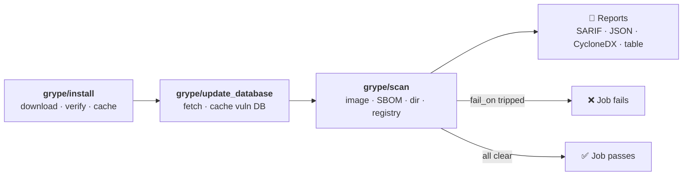

<div align="center">


# Grype Orb for CircleCI

**Vulnerability scanning for your CircleCI pipelines in a few lines of YAML.**

Install [Grype](https://github.com/anchore/grype) safely, scan container images, SBOMs, and source trees,<br />
and fail the build when a vulnerability crosses the severity line you set.

[](https://circleci.com/gh/juburr/grype-orb)
[](https://circleci.com/developer/orbs/orb/juburr/grype-orb)
[](#platforms)
[](#checksum-verification)
[](https://github.com/juburr/grype-orb/blob/main/LICENSE)
[](https://discuss.circleci.com/c/ecosystem/orbs)

[**Quick Start**](#-quick-start) · [**Commands**](#-commands) · [**Guides**](#-guides) · [**Security**](#-security) · [**Contributing**](#-contributing)

</div>

<br />

## ✨ Why Grype Orb?

<table>
  <tr>
    <td width="33%" valign="top">
      <h3>🔒 Secure by default</h3>
      <p>No <code>sudo</code>, anywhere. Every Grype binary is checked against a pinned SHA-512 checksum, and an unknown version fails closed.</p>
    </td>
    <td width="33%" valign="top">
      <h3>🎯 Scans more than images</h3>
      <p>Container images, SBOMs, directories, registries, OCI layouts, CPE lists, and Zarf packages. Anything Grype can read.</p>
    </td>
    <td width="33%" valign="top">
      <h3>🚦 Gates your builds</h3>
      <p>Set <code>fail_on: high</code> and the job fails when a match at or above that severity turns up. Add <code>only_fixed</code> to see only findings you can fix.</p>
    </td>
  </tr>
  <tr>
    <td width="33%" valign="top">
      <h3>📄 Reports for your tools</h3>
      <p>SARIF, JSON, CycloneDX, or a readable table. List several formats in <code>output</code> to render them all from a single scan.</p>
    </td>
    <td width="33%" valign="top">
      <h3>🧾 Understands VEX</h3>
      <p>Pass OpenVEX documents to drop findings you have marked <code>not_affected</code> or <code>fixed</code>, so they stop failing builds.</p>
    </td>
    <td width="33%" valign="top">
      <h3>⚡ Fast and multi-arch</h3>
      <p>Caches the Grype download and the vulnerability database between jobs, and installs the native amd64 or arm64 build for each machine.</p>
    </td>
  </tr>
</table>



## 🚀 Quick Start

Add the orb, install Grype, and scan. The job below fails if the image has any
vulnerability rated `high` or `critical`:

```yaml
version: 2.1

orbs:
  grype: juburr/grype-orb@0.5.0

jobs:
  vulnerability_scan:
    docker:
      - image: cimg/base:current-22.04
    steps:
      - grype/install
      - grype/update_database
      - grype/scan:
          source: gcr.io/distroless/base:latest
          fail_on: high

workflows:
  security:
    jobs:
      - vulnerability_scan
```

With the default `output`, `scan` writes a SARIF report to
`grype-scan-results.sarif`.

CircleCI has no `latest` tag for registry orbs, so pin a release. The orb
version badge above shows the newest one.

<details>
<summary><b>Full example: pinned versions, strict checksums, and a SARIF report</b></summary>
<br />

```yaml
version: 2.1

orbs:
  grype: juburr/grype-orb@0.5.0

parameters:
  cimg_base_version:
    type: string
    default: "current-22.04"
  grype_version:
    type: string
    default: "0.119.0"

jobs:
  scan_container:
    docker:
      - image: cimg/base:<< pipeline.parameters.cimg_base_version >>
    parameters:
      image:
        type: string
        default: "gcr.io/distroless/base:latest"
        description: "container image to scan"
    steps:
      - checkout
      - grype/install:
          caching: true
          verify_checksums: strict
          version: << pipeline.parameters.grype_version >>
      - grype/update_database
      - grype/scan:
          fail_on: critical
          source: << parameters.image >>
          output: sarif=gcr.distroless.base.grype.sarif
      - run:
          name: Log Scan Results
          command: cat gcr.distroless.base.grype.sarif
```

</details>

## 🧰 Commands

| Command | What it does |
| --- | --- |
| [`grype/install`](#install) | Downloads Grype from its official GitHub releases, verifies the SHA-512 checksum, and installs it to a user-owned directory. Run this first. |
| [`grype/update_database`](#update_database) | Downloads the latest vulnerability database, with optional caching. |
| [`grype/scan`](#scan) | Scans an image, SBOM, directory, or other Grype source, writes reports, and can fail the job by severity. |

### `install`

| Parameter | Type | Default | Description |
| --- | --- | --- | --- |
| `version` | string | `0.119.0` | Grype version to install. |
| `verify_checksums` | enum | `strict` | `strict`, `known_versions`, or `"false"`. See [Checksum verification](#checksum-verification). |
| `caching` | boolean | `true` | Cache the Grype download, keyed by version, architecture and home directory. Only verified downloads are cached, and they are verified again when restored. |
| `install_path` | string | `$HOME/bin` | Absolute directory for the binary that does not need root. Created if needed, and added to `PATH` if it isn't already there. |

### `update_database`

| Parameter | Type | Default | Description |
| --- | --- | --- | --- |
| `caching` | boolean | `true` | Cache the vulnerability database. Recommended, because Anchore's database host can be slow or fail at peak hours. |
| `database_dir` | string | `~/.cache/grype/db` | Directory for the database. A leading `~` is expanded to `$HOME`. It is exported as `GRYPE_DB_CACHE_DIR` to the job's later steps, so `scan` uses the same database. |

### `scan`

| Parameter | Type | Default | Description |
| --- | --- | --- | --- |
| `source` | string | *required* | Any Grype source: an image reference, or a scheme such as `sbom:`, `dir:`, `registry:`, `docker:`, `oci-dir:`, `cpes:`, or `zarf:`. |
| `fail_on` | enum | | `negligible`, `low`, `medium`, `high`, or `critical`. Fails the step when a vulnerability at or above this severity is found. Leave empty to report without gating. |
| `only_fixed` | boolean | `false` | Report only vulnerabilities that have a fix. |
| `config` | string | | Grype configuration file, passed as `--config`. |
| `vex` | string | | Comma-separated OpenVEX document paths. See [VEX](#vex). |
| `output` | string | `sarif=grype-scan-results.sarif` | Comma-separated `format` or `format=file` entries, in Grype's `-o` syntax. See [Reports](#reports). |

## 📚 Guides

### Checksum verification

`install` verifies the SHA-512 checksum of the Grype binary against a lookup
table maintained in this orb. The `verify_checksums` parameter controls what
happens when the requested `version` is missing from that table:

| Value | Listed version | Unlisted version |
| --- | --- | --- |
| `strict` (default) | Verified | Fails before downloading anything |
| `known_versions` | Verified | Installed unverified, with a warning |
| `"false"` | Not verified | Not verified (not recommended) |

If you pin a Grype release newer than this orb knows about, upgrade the orb or
contribute the checksum; set `verify_checksums: known_versions` only as a
temporary opt-out.

### Scan sources and policy

`source` takes any source syntax supported by Grype: an image reference, or
an explicit scheme such as `sbom:`, `dir:` or `registry:`, including `cpes:`
files and `zarf:` package archives.

```yaml
- grype/scan:
    source: sbom:./forge.cdx.json
    config: .grype.yaml
    only_fixed: true
    fail_on: high
    output: sarif=forge.grype.sarif

- grype/scan:
    source: dir:.
    output: json=repository.grype.json
```

The `config` parameter is passed to Grype as `--config`, allowing a committed
policy file to carry ignore rules. Repositories can pair that file with their
own CI validation for required rationale and expiry metadata. `only_fixed`
passes `--only-fixed`. The existing `fail_on` parameter remains optional;
leave it empty to report findings without gating.

### VEX

`vex` takes a comma-separated list of [OpenVEX](https://openvex.dev) documents.
Each path is passed to Grype as its own `--vex` flag, and a path that does not
exist fails the step before scanning. Matches that a document marks
`not_affected` or `fixed` move to `ignoredMatches` in JSON output and do not
count toward `fail_on`. `affected` and `under_investigation` statements filter
nothing.

```yaml
- grype/scan:
    source: sbom:./forge.cdx.json
    config: .grype.yaml
    vex: vex/forge.openvex.json,vex/release-1.4.openvex.json
    fail_on: high
    output: json=forge.grype.json
```

Behavior verified against Grype 0.119.0, the default version:

- **Config file.** A config file's `vex-documents` key also works. Relative
  paths in it resolve against the working directory, not the config file's
  location.
- **`vex` replaces `vex-documents`.** Grype does not merge the two lists. When
  `vex` is set, documents from Grype's own configuration stop applying,
  whether they come from the file named by `config`, a config file Grype
  finds on its own (such as `./.grype.yaml`), or `GRYPE_VEX_DOCUMENTS`. The
  orb asks Grype for its resolved configuration (`grype config --load`,
  available from Grype 0.78.0) and prints a warning when it lists any. Keep
  every document in one of the two places.
- **Vulnerability IDs.** A statement must name the ID Grype reports. OS
  packages are reported by CVE, but most language packages are reported by
  GitHub advisory (for example `GHSA-xvch-5gv4-984h` rather than
  `CVE-2021-44906`). Name that ID, or list it under the statement's `aliases`.
- **Products.** For every source type (`sbom:`, `dir:`, images), a statement
  whose product is the vulnerable package's purl applies, such as
  `pkg:apk/alpine/zlib@1.2.11-r3`. For image sources, a product naming the
  image as a `pkg:oci` purl with its digest also applies, with the package
  purl listed as a subcomponent.

### Reports

`output` uses Grype's own `-o` syntax: a comma-separated list of entries, each
`format` or `format=file`. The formats are `json`, `table`, `cyclonedx`,
`cyclonedx-json`, `sarif` and `template`. An entry with a file writes that
report to the file, creating its parent directories; the file may itself
contain `=`, since only the first one separates the format. An entry without
a file prints the report in the step log, so at most one entry can leave out
the file. The default, `sarif=grype-scan-results.sarif`, writes one SARIF
report.

```yaml
# One JSON report, in a directory that is created if needed.
- grype/scan:
    source: sbom:./forge.cdx.json
    output: json=reports/forge.grype.json

# A JSON and a SARIF file, plus a table in the step log, from one scan.
- grype/scan:
    source: sbom:./forge.cdx.json
    output: json=forge.grype.json,sarif=forge.grype.sarif,table
```

A single entry works with every Grype version: Grype prints the report on
stdout, and the orb redirects it to the file.

Several entries render every report from a single scan, so they all come from
the same cataloging pass and the same vulnerability database snapshot.
Separate scans could each pick up a database update, and they repeat the image
pull and cataloging work. Each entry becomes its own `-o` flag, and Grype
writes the files itself. This needs Grype 0.104.1 or later; the default
version qualifies. Older releases either lack multiple outputs (before 0.64.0)
or can write registry credentials into JSON written straight to a file (0.68.0
through 0.104.0, [GHSA-6gxw-85q2-q646](https://github.com/anchore/grype/security/advisories/GHSA-6gxw-85q2-q646)),
so the step fails before scanning on them.

The `template` format also needs a Go template file, which `output` cannot
name. Set it with `output-template-file` in the Grype configuration file
passed as `config`, or with the `GRYPE_OUTPUT_TEMPLATE_FILE` environment
variable.

When `fail_on` trips, every report is still written before the step fails.

## 🔐 Security

### Secure by design

- **Least Privilege**: Installs to a user-owned directory by default, with no `sudo` usage anywhere in this orb.
- **Integrity**: Checksum validation of all downloaded binaries using SHA-512, failing closed by default when a version's checksum is unknown (see [Checksum verification](#checksum-verification)).
- **Provenance**: Installs directly from Grype's official [releases page](https://github.com/anchore/grype/releases/) on GitHub. No third-party websites, domains, or proxies are used.
- **Confidentiality**: All secrets and environment variables are handled in accordance with CircleCI's [security recommendations](https://circleci.com/docs/security-recommendations/) and [best practices](https://circleci.com/docs/orbs-best-practices/).
- **Privacy**: No usage data of any kind is collected or shipped back to the orb developer.

### Platforms

- Linux `amd64` (`x86_64`) and `arm64` (`aarch64`), on Docker or machine executors, including CircleCI's Arm resource classes. `install` detects the architecture with `uname -m`, downloads the matching Grype release, and verifies it against a per-architecture checksum table. Any other platform is a hard error.
- The binary cache key includes the architecture, so amd64 and arm64 jobs never share a cached download.
- If `install_path` is not on `PATH` (as can happen on machine executors), `install` creates it and adds it to `PATH` for the job's later steps.

### Network egress for locked-down runners

If you run a locked-down, self-hosted CircleCI pipeline on-prem, allow outbound
access to these hosts:

| Host | Why |
| --- | --- |
| `github.com` | Download and installation of the Grype tool. Release download URLs answer with a redirect to one of GitHub's asset hosts below. |
| `release-assets.githubusercontent.com` | The host GitHub currently redirects Grype release downloads to (tarballs and checksum files alike). |
| `objects.githubusercontent.com` | GitHub's previous redirect host for release downloads. Allow it too, so installs keep working if a download is routed there. |
| `grype.anchore.io` | Vulnerability database updates on Grype 0.88.0 and later, including the default version. Both the database listing and the database archive are served from this host. |
| `toolbox-data.anchore.io` | Vulnerability database updates on Grype 0.87.0 and earlier, and the update check Grype runs at startup on every version. If this host is blocked, the check logs an error and the scan continues. Set `GRYPE_CHECK_FOR_APP_UPDATE=false` to skip it. |
| Your registries | Any registries your `scan` sources pull images from. |

## ⬆️ Upgrading

The next release renames or removes these commands and parameters:

| Old | New |
| --- | --- |
| `scan_image` command | `scan` |
| `scan_image.image` | `source`, which is now required |
| `scan_image.output_format` + `output_file` | `output: <format>=<file>` |
| `scan_image.output_formats` | `output`, with the same comma-separated `format=file` list |
| `log_version` command | removed; `install` already logs the version |
| `update_database.database_path` | `database_dir` |

Behavior changes:

- `output` can also print a report in the step log: an entry without
  `=file`, such as `output: table`.
- Parent directories of `output` files are created.
- `database_dir` defaults to `~/.cache/grype/db` (it was
  `/home/circleci/.cache/grype/db`, the same directory on CircleCI's images).
  It is exported as `GRYPE_DB_CACHE_DIR` to the job's later steps, so `scan`
  and `grype db list` now use a non-default directory too.
- The `GRYPE_VERSION` environment variable is no longer exported.

## 🎨 Logos

Need the logo for a slide, a dashboard, or a blog post? Square PNGs with
transparent backgrounds live in [`assets/logos`](assets/logos):

| Size | [64 px](assets/logos/grype-orb-64px.png) | [128 px](assets/logos/grype-orb-128px.png) | [256 px](assets/logos/grype-orb-256px.png) | [512 px](assets/logos/grype-orb-512px.png) | [1024 px](assets/logos/grype-orb-1024px.png) |
| --- | :---: | :---: | :---: | :---: | :---: |
| Use it for | Favicons, small icons | Avatars, sidebars | Docs, READMEs | Slides, blog posts | Print, large banners |

## 🤝 Contributing

Contributions are welcome! Issues and pull requests are the way in.

- **New Grype release?** Run `src/scripts/install_hash.sh -v <version>` to
  print the SHA-512 entries for both architectures, then paste them into the
  checksum table in `src/scripts/install.sh`.
- **Before opening a PR**, run the offline tests with `bash tests/install_test.sh`
  and `bats tests`, and lint the scripts with `shellcheck src/scripts/*.sh`. CI
  runs them all, along with the orb linter and integration tests on CircleCI.

## 📜 License

Released under the [MIT License](LICENSE).

<div align="center">
<br />
<sub>An unofficial, community-maintained orb. Grype is an open source project by <a href="https://anchore.com">Anchore</a>.</sub>
</div>
